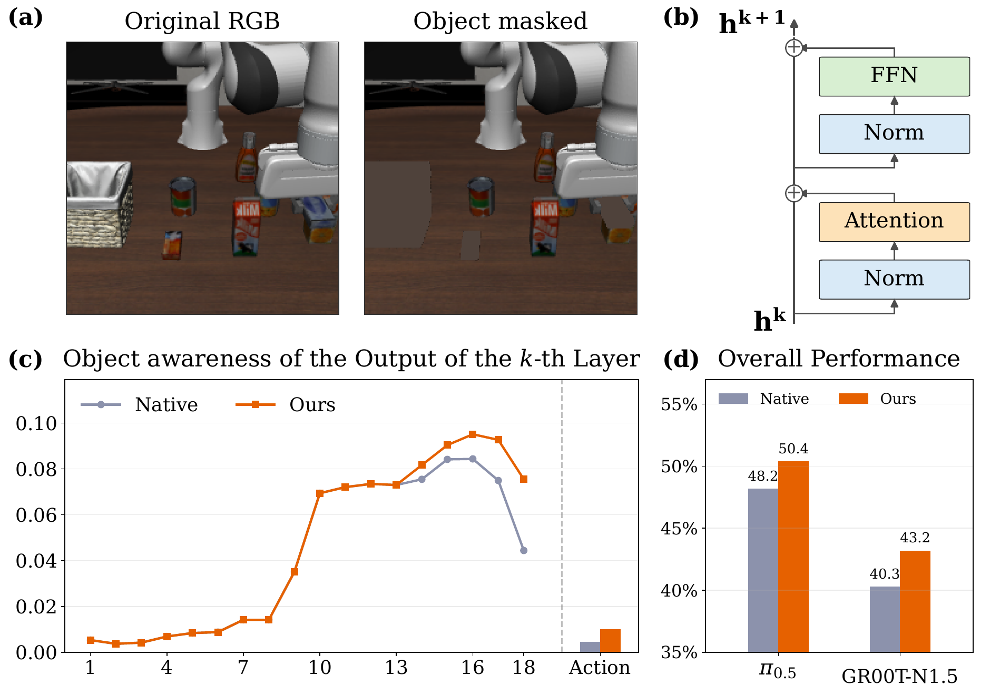

<h1 align="center">STAR: Steering Action Representations with Proprioception for VLA Inference</h1>

<p align="center">
  <a href="https://pku-value-lab.github.io/STAR/"></a>
  <a href="https://github.com/PKU-VaLuE-Lab/STAR"></a>
  <a href="LICENSE"></a>
</p>

<p align="center">
  Guangyu Zhao<sup>1,*</sup>&emsp;
  Yongchang Zhang<sup>1,*</sup>&emsp;
  Haoxuan Ru<sup>1,*</sup>&emsp;
  Kaichen He<sup>1</sup>&emsp;
  Haoran Wen<sup>2</sup>&emsp;
  Kun Zhan<sup>2</sup>&emsp;
  Yin Li<sup>3</sup>&emsp;
  Yiwu Zhong<sup>1,†</sup>
</p>

<p align="center">
  <sup>1</sup>Peking University&emsp;
  <sup>2</sup>Li Auto&emsp;
  <sup>3</sup>University of Wisconsin-Madison
</p>

<p align="center">
  * Equal contribution.&emsp;† Corresponding author.
</p>

## STAR Overview

<p align="center">
  
</p>

### Abstract

Vision-language-action models (VLAs) map language instructions and visual observations to robot actions, showing strong capabilities across robotic manipulation tasks. However, in a probing experiment, we find that action representations near the action output do not fully preserve task-relevant visual grounding. Motivated by this late-layer grounding gap, we introduce STAR, for **ST**eering **A**ction **R**epresentations, a training-free inference method for pre-trained VLAs.

STAR applies an exponential moving average over late-layer residual updates, allowing later action representations to inherit object-aware update directions from earlier layers without model updates or architectural changes. It further uses recent proprioceptive states to adapt the mixing strength, using conservative mixing when execution dynamics change rapidly. Experiments on robot manipulation benchmarks show that STAR improves late-layer object awareness and increases average task success rates by 4.0 percentage points.

This repository currently releases the OpenPI π<sub>0.5</sub> implementation for LIBERO-PRO. The OpenVLA, GR00T-N1.5, SimplerEnv, and real-robot implementations are not included in this release.

## Main Results

### SimplerEnv

| Backbone | Native | DTP | STAR |
|:--|--:|--:|--:|
| GR00T-N1.5 | 41.0 | 40.0 | **46.3** |
| OpenVLA | 30.3 | 34.3 | **36.0** |

Average task success rate (%). The OpenVLA average is computed over the five available tasks.

### LIBERO-PRO

| Backbone | Native | DTP | STAR |
|:--|--:|--:|--:|
| GR00T-N1.5 | 40.3 | 40.3 | **43.2** |
| π<sub>0.5</sub> | 48.2 | 47.7 | **50.4** |

Average success rate (%) across the five LIBERO-PRO evaluation splits.

### Real Robot

| Method | Successes / Trials | Success Rate |
|:--|--:|--:|
| Native | 17 / 40 | 42.5% |
| STAR | **19 / 40** | **47.5%** |

STAR adds 3.3% inference latency over native inference on a single NVIDIA RTX 3090.

## Usage

### Install

The OpenPI environment requires Linux and an NVIDIA GPU. The upstream estimate for inference is more than 8 GB of GPU memory; the repository has been tested on Ubuntu 22.04.

```bash
git clone --recurse-submodules https://github.com/PKU-VaLuE-Lab/STAR.git
cd STAR

GIT_LFS_SKIP_SMUDGE=1 uv sync
GIT_LFS_SKIP_SMUDGE=1 uv pip install -e .
```

Install [uv](https://docs.astral.sh/uv/getting-started/installation/) before running these commands. `GIT_LFS_SKIP_SMUDGE=1` is required when pulling LeRobot. See [docs/docker.md](docs/docker.md) for the Docker setup.

### LIBERO-PRO Setup

Install LIBERO-PRO in the evaluator environment and confirm that it registers the following suites:

```text
libero_10_lan
libero_10_object
libero_10_swap
libero_10_task
libero_10_env
```

The checkpoint is not included. The commands below use the public `pi05_libero` checkpoint, which OpenPI downloads automatically.

### Evaluation

Start native inference:

```bash
uv run scripts/serve_policy.py \
  --env LIBERO \
  --inference-mode NATIVE
```

Start STAR with the paper configuration for π<sub>0.5</sub> on LIBERO-PRO:

```bash
uv run scripts/serve_policy.py \
  --env LIBERO \
  --inference-mode STAR \
  --star.beta-min 0.25 \
  --star.beta-max 0.55 \
  --star.beta-kappa 4.25 \
  --star.phase-coeff-c 1.0 \
  --star.phase-coeff-v 1.0 \
  --star.phase-coeff-j -0.375 \
  --star.phase-coeff-w -2.0 \
  --star.correction-last-n-layers 6 \
  --star-env-control-hz 10 \
  --star-replan-steps 5
```

Both modes use the same checkpoint, transforms, and normalization statistics.

With the policy server listening on port 8000, run one LIBERO-PRO suite:

```bash
python examples/libero/main.py \
  --args.task-suite-name libero_10_lan \
  --args.host 127.0.0.1 \
  --args.port 8000 \
  --args.env-control-hz 10 \
  --args.replan-steps 5
```

Replace `libero_10_lan` with the other suite names for the full evaluation. The evaluator runs 50 trials per task with seed 7 by default.

For a quick smoke run:

```bash
python examples/libero/main.py \
  --args.task-suite-name libero_10_lan \
  --args.max-tasks 1 \
  --args.num-trials-per-task 1
```

### Local Checkpoint

Append the checkpoint subcommand to use a compatible local checkpoint:

```bash
uv run scripts/serve_policy.py \
  --inference-mode STAR \
  --star.beta-min 0.25 \
  --star.beta-max 0.55 \
  --star.beta-kappa 4.25 \
  --star.phase-coeff-c 1.0 \
  --star.phase-coeff-v 1.0 \
  --star.phase-coeff-j -0.375 \
  --star.phase-coeff-w -2.0 \
  --star.correction-last-n-layers 6 \
  --star-env-control-hz 10 \
  --star-replan-steps 5 \
  policy:checkpoint \
  --policy.config pi05_libero \
  --policy.dir /path/to/pi05_libero/checkpoint
```

The checkpoint directory must contain compatible `params/` and `assets/` trees.

### Tests

```bash
uv run pytest \
  src/openpi/inference/star/controller_core_test.py \
  src/openpi/inference/star/scheduler_test.py \
  src/openpi/policies/policy_star_test.py
```
